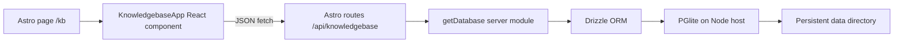

# Knowledgebase page and API design

## Status and purpose

This document describes the implemented knowledgebase feature in AppOne. The page at `/kb` stores useful links, categories, and notes so previously found answers can be located again. It follows the project's TODO architecture: an Astro page hosts a React interface, Astro API routes handle JSON requests, and Drizzle writes to the server's PGlite database.

The current knowledgebase is one shared collection. It has no user accounts, ownership, or access control.

## Architecture



`/kb` uses the shared `PageShell` and loads `KnowledgebaseApp` with `client:load`. The page shell labels the route **Knowledgebase** in its navigation. The browser holds the current list and filter state; it does not open PGlite or access the database files. Both API route files set `prerender = false`, so the standalone Node adapter handles requests at runtime.

### Main files

| File | Responsibility |
| --- | --- |
| `src/pages/kb.astro` | Defines the `/kb` page, metadata, page shell, and hydrated React component. |
| `src/components/knowledgebase/KnowledgebaseApp.tsx` | Loads entries and implements search, filtering, create, edit, and delete interactions. |
| `src/components/knowledgebase/KnowledgebaseApp.css` | Table, responsive layout, form drawer, confirmation dialog, and state styling. |
| `src/components/PageShell.astro` | Adds the Knowledgebase navigation label. |
| `src/pages/api/knowledgebase/index.ts` | Lists and creates entries. |
| `src/pages/api/knowledgebase/[id].ts` | Updates and deletes entries by numeric ID. |
| `src/db/schema.ts` | Defines the `knowledgebase` table. |
| `src/db/server.ts` | Opens the shared PGlite database and applies pending migrations on first use. |
| `drizzle/0001_flat_silhouette.sql` | Creates the knowledgebase table. |
| `scripts/migrate.mjs` | Applies migrations to PGlite from the command line. |

## Data model

The `knowledgebase` table has these columns. Drizzle maps the timestamp column names to the camel-case API fields shown below.

| Database column | API field | Type and rule | Use |
| --- | --- | --- | --- |
| `id` | `id` | Serial primary key | Entry identifier. |
| `catlevel1` | `catlevel1` | Non-null text | Primary category. |
| `catlevel2` | `catlevel2` | Nullable text | Subcategory. |
| `url1` | `url1` | Non-null text | Primary saved link. |
| `url2` | `url2` | Nullable text | Secondary link. |
| `note1` | `note1` | Nullable text | First user note. |
| `note2` | `note2` | Nullable text | Second user note. |
| `created_at` | `createdAt` | Non-null timestamp with time zone, default `now()` | Creation time. |
| `updated_at` | `updatedAt` | Non-null timestamp with time zone, default `now()` | Last edit time. |

The API sets `updatedAt` when an entry is patched. The schema has no full-text index, foreign key, unique constraint, or soft-delete column.

## Front-end behavior

The page loads all entries with `GET /api/knowledgebase` when the React component mounts. It shows a loading state, an empty collection state, and an empty search result state. Load failures appear in an alert with a Retry action.

Entries appear in a compact table with **Category**, **Links**, **Notes**, **Added**, and row actions. Both category levels and both URLs can appear in a row. Notes are shortened visually to keep rows compact; the full text is available in the edit form and as a title on hover. Link labels show the domain and path, and valid HTTP(S) links open in a new tab. The table scrolls horizontally on narrower screens.

Search runs in the browser across both categories, both URLs, and both notes, ignoring letter case. The category selector filters by the exact primary category. These controls do not make new API requests. The count above the table shows how many entries remain visible. A successful save clears both controls so the saved entry is visible.

**New entry** and **Edit** open a side drawer with all six editable fields. The primary category and URL are required. The UI trims values, sends empty optional fields as `null`, and requires entered URLs to be complete HTTP(S) addresses. It disables repeated submission while saving and displays API errors in the drawer. A successful create prepends the returned entry to local state; a successful edit replaces that row. Neither operation reloads the full list.

**Delete** opens a confirmation dialog. On success, the component removes the row from local state. On failure, it keeps the row and shows an error above the table. Escape and backdrop clicks close the editor and confirmation dialog when no operation is pending.

## API contract

Responses are JSON with `Content-Type: application/json; charset=utf-8` and `Cache-Control: no-store`. Successful create and update calls return the complete entry, including `id`, nullable fields, and timestamps. Timestamps serialize as ISO strings.

| Method | Route | Request | Successful response |
| --- | --- | --- | --- |
| `GET` | `/api/knowledgebase` | None | HTTP 200; array ordered by `createdAt` descending, then `id` descending. |
| `POST` | `/api/knowledgebase` | JSON with required `catlevel1` and `url1`; optional `catlevel2`, `url2`, `note1`, `note2` | HTTP 201; created entry. |
| `PATCH` | `/api/knowledgebase/:id` | JSON with at least one editable field | HTTP 200; updated entry. |
| `DELETE` | `/api/knowledgebase/:id` | None | HTTP 200; `{ "id": number }`. |

Example create request:

```json
{
  "catlevel1": "Research",
  "catlevel2": "AI tools",
  "url1": "https://example.com/answer",
  "url2": null,
  "note1": "Summary of the useful result",
  "note2": null
}
```

The server trims submitted strings. `catlevel1` and `url1` must be nonempty strings. On create, omitted optional fields become `null`; supplied optional fields must be strings or `null`. On patch, optional fields may be set to `null` to clear them. Unknown fields are ignored, and an update with no recognized editable field returns HTTP 400. The ID must be a positive safe integer written with decimal digits.

Malformed JSON, invalid values, invalid IDs, and empty updates return HTTP 400. An update or delete for an absent ID returns HTTP 404. Database errors return HTTP 500 with a generic JSON error; the server logs the underlying error. The API itself only checks that `url1` is nonempty text. HTTP(S) URL validation is currently a front-end rule, so direct API clients can store other text in URL fields. There is no single-entry `GET /api/knowledgebase/:id` route.

## Database lifecycle and migrations

The TODO and knowledgebase tables share one PGlite database. `src/db/server.ts` resolves `TODO_DB_DIR`, or defaults to `data/todo-pglite` relative to the process working directory. The name `TODO_DB_DIR` is retained for compatibility with the existing app. PGlite stores a **directory** of files on the Node host, not a browser database or one `.db` file. The project ignores `data/` in Git.

On the first API request, `getDatabase()` opens one PGlite instance per Node process and applies pending migrations from `drizzle/`. The knowledgebase table was added in migration `0001_flat_silhouette.sql`; the migration journal and snapshot are in `drizzle/meta/`. Run the server from the project directory so it can find migrations. Do not run multiple Node processes against the same PGlite data directory.

For a schema change, edit `src/db/schema.ts`, run `npm run db:generate`, review the new SQL and metadata, and commit them. To apply pending migrations before starting the app, run `npm run db:migrate` while the app is stopped. That script uses the same `TODO_DB_DIR` setting as the server and closes its PGlite instance when finished. `npx drizzle-kit migrate` expects a separate PostgreSQL connection and is not the command for this embedded PGlite setup. Do not modify a migration already applied to persistent data; generate a new one.

## Running the feature

From this project directory, start the dev server in background mode as required by the project:

```sh
astro dev --background
```

Then open `/kb` on the local app. Use `astro dev status`, `astro dev logs`, and `astro dev stop` to manage the background server. For production, build with `npm run build` and run `npm start` on a Node host with a persistent, writable `TODO_DB_DIR`. The API and PGlite require the Node server; a static-only deployment cannot serve this feature.

## Current boundaries

- The API is shared and unauthenticated. Anyone who can reach it can read, add, change, or delete entries.
- Search and category filtering operate on the full list already loaded into the browser. There is no server pagination or live synchronization across tabs.
- Entries are hard-deleted. Restore depends on a backup of the PGlite data directory.
- The UI permits only HTTP(S) links, but the API does not enforce that rule.
