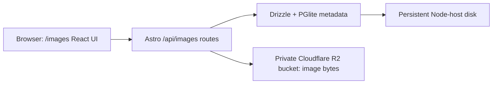

# Images CRUD design

**Status:** Agreed design, ready for implementation · **Source:** [03-Image-CRUD-PRD.md](./03-Image-CRUD-PRD.md)

## Goal and scope

Add `/images` to upload multiple images, browse them in a responsive grid or list, edit their display names and descriptions, view originals, and delete them. The first release uses placeholder `userId = 'user1'`. Image bytes live in Cloudflare R2. The existing server-side PGlite database is the source of truth for image metadata.

The PRD also suggests a metadata JSON file in R2. The agreed design uses PGlite instead: the application already uses it, and updating one image record does not require rewriting a shared JSON object. R2 stores image bytes only.

## Existing application fit

The project runs Astro with the standalone Node adapter. `/todo` and `/kb` use Astro pages, client-loaded React components, Astro API routes, Drizzle migrations, and a PGlite directory on persistent disk. `/images` follows the same structure and appears in `PageShell` navigation. The existing `TODO_DB_DIR` setting continues to locate the shared database; it is not an images-only database.

## User experience

1. The page loads the newest images first and offers a grid/list toggle. Each item shows a thumbnail, display name, file type, size, and upload date. Selecting an item opens a larger preview and its details. Search by display name is server-side; the list uses cursor pagination with a default page size of 30.
2. Upload accepts multiple files through a file picker or drop zone. The UI uploads each file independently, shows per-file progress/result, and keeps successful items if another file fails. A retry action is available for failed files.
3. Rename edits `fileName`, the display name. The R2 key stays fixed, so renaming does not copy or move the object. The original uploaded name remains in `originalName`. The description can be edited alongside the display name.
4. Delete asks for confirmation, removes the image from the visible collection, and removes its R2 object. Show a recoverable error if deletion fails.
5. Show explicit loading, empty collection, no search results, and service error states. Keyboard access and accessible labels apply to upload, preview, edit, and delete controls.

**Upload policy:** JPEG, PNG, WebP, and GIF; at most 10 MiB per file; no SVG; no image transformation. The UI can show original files as thumbnails using `object-fit`; large originals may make a thumbnail-heavy page slower.

## Data model

Add an `images` table through a new Drizzle migration. Existing tables and migrations remain intact.

| Field | Type | Purpose |
| --- | --- | --- |
| `id` | UUID text, primary key | Stable public identifier, generated by the server. |
| `userId` | Text, non-null | Always `user1` in this release; indexed with list ordering for future per-user queries. |
| `fileName` | Text, non-null | Editable display name. |
| `originalName` | Text, non-null | Name at upload, never changed by rename. |
| `desc` | Text, nullable | Editable description, matching the PRD field name. |
| `r2Key` | Text, unique, non-null | Immutable object location, e.g. `images/shared/<uuid>.png`. |
| `contentType` | Text, non-null | Validated MIME type. |
| `size` | Integer, non-null | Byte count. |
| `width`, `height` | Integer, nullable | `null` in the first release; reserved for later image inspection. |
| `status` | Text, non-null | `ready` or `deleting`; supports retry after partial deletion. |
| `createdAt`, `updatedAt` | Timestamp with timezone | Server managed. |

The R2 object key uses `images/user1/<uuid>.<validated-extension>`. The uploaded filename never becomes a path component. A future user model can introduce other user-specific prefixes and access checks without changing existing IDs.

The React UI has one `USER_ID = 'user1'` placeholder and sends it as `X-Image-User-Id: user1` on its JSON and upload requests. The server also resolves the current user to `user1` for this release, rejects any different supplied ID, and scopes all metadata operations by `userId`. Browser image requests cannot send that custom header, so the content route uses the server's resolved ID. When authentication arrives, a server-side session or verified token replaces that resolver; the client-supplied placeholder must not be treated as proof of identity.

## API proposal

All routes run on the Node server and return JSON errors with appropriate HTTP status codes. Image bytes are returned by the content route. The bucket remains private and R2 credentials stay server-side.

| Method | Route | Behavior |
| --- | --- | --- |
| `GET` | `/api/images?cursor=...&limit=...&q=...` | List the current user's `ready` metadata, newest first; default limit 30, maximum 100. |
| `POST` | `/api/images` | Upload one multipart `file` per request, with optional `fileName` and `desc`; return `201` and metadata. The page sends multiple requests for a multi-file selection. |
| `GET` | `/api/images/:id/content` | Stream image bytes from R2 with stored content type and safe caching headers. |
| `PATCH` | `/api/images/:id` | Update `fileName` and/or `desc`; return updated metadata. Scope by the server-resolved user. |
| `DELETE` | `/api/images/:id` | Delete image and metadata; return `204` on success. Scope by the server-resolved user. |

The list response provides an app-relative `contentUrl` for each item. It never exposes R2 credentials or a raw object key as an editable client field. Invalid IDs, missing files, unsupported content, excessive sizes, and malformed requests receive explicit `4xx` responses. R2 and database failures receive generic `5xx` responses while the server logs the cause.

## Upload, rename, and delete behavior

**Upload:** Validate the request before storing anything: file count (one per request), size, extension, MIME type, and image signature. Generate the UUID/key, upload to R2 with `Content-Type`, then insert the PGlite row. If the insert fails, attempt to delete the new R2 object and log any cleanup failure. Only a completed row is listed.

**Rename:** Validate a nonempty display name and length limit. Update only metadata and `updatedAt`. Keep `originalName` and `r2Key` unchanged.

**Delete:** Mark the row `deleting`, delete its R2 object, then delete the row. Exclude `deleting` rows from normal listing. If either final step fails, retry can resume from the `deleting` row; R2 deletion is treated as idempotent. A small reconciliation command or startup task should retry stranded deletions and report unresolved objects. This prevents a failed database delete from resurfacing a broken visible item.

## Configuration and deployment

Use the R2 S3-compatible API from server code with `@aws-sdk/client-s3`, `region: 'auto'`, and the configured endpoint. The existing ignored `/3appone/.env` contains `R2_ACCOUNT_ID`, `R2_ACCESS_KEY_ID`, `R2_SECRET_ACCESS_KEY`, `R2_BUCKET_NAME`, `R2_PUBLIC_BASE_URL`, and `R2_ENDPOINT_URL`. Use the first four and `R2_ENDPOINT_URL` for the server client. The private-bucket design does not need `R2_PUBLIC_BASE_URL`. Keep values server-side, document placeholder names in `.env.example`, and do not commit secrets or expose them through `PUBLIC_` variables.

The PRD's `/2appone/.env` path is superseded by the user's confirmed `/3appone/.env`. No credential file needs to be copied.

Production needs a persistent PGlite directory, one Node process per directory, outbound access to R2, and the R2 variables in the server environment. Backups of PGlite metadata and R2 objects should be coordinated; restoring only one side can create missing or orphaned images.

## Access and security

The current app has no authentication. `user1` is a placeholder for data partitioning, not an access control. Anyone who can reach the deployed page and API can act as `user1`, including uploading, renaming, viewing, and deleting images. A public deployment requires an authentication layer or external access gate if those actions should be restricted. Keep the R2 bucket private regardless.

## Implementation map

- `src/pages/images.astro`: page and `PageShell` integration.
- `src/components/images/ImagesApp.tsx` and CSS: upload queue, grid/list, preview, edit, and deletion UI.
- `src/pages/api/images/index.ts`, `[id].ts`, and `[id]/content.ts`: metadata and file routes.
- `src/lib/r2/server.ts`: server-only R2 client and object helpers.
- `src/db/schema.ts` plus a new `drizzle/` migration: metadata table.
- `.env.example` and deployment notes: configuration contract without values.

## Verification plan

Check the app and migration with `npm run check` and `npm run build`. With a test R2 bucket, verify valid multi-file upload, list/preview after reload and server restart, rename without changing `r2Key`, delete of bytes and row, and independent success/failure within one selection. Exercise invalid type, oversized file, malformed IDs, missing object, and R2/database failures. Verify that API responses and built client assets contain no credentials.

## Decisions recorded

1. Metadata lives in PGlite; image bytes live in R2.
2. The frontend has a hard-coded `user1` placeholder; the server also resolves to `user1` until real authentication is added.
3. R2 configuration comes from the existing `/3appone/.env`.
4. Uploads accept JPEG, PNG, WebP, and GIF, up to 10 MiB each.
5. The first release includes bounded pagination and server-side name search; `desc` follows the PRD spelling and dimensions remain nullable.
